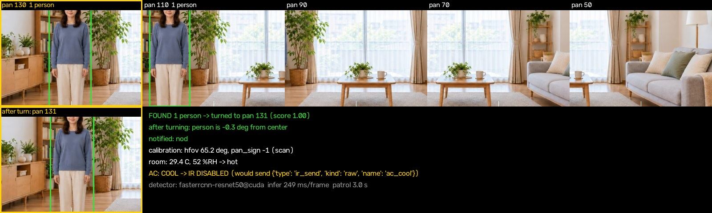

# スタックチャンの見張り番（mihari）

卓上の小型ロボット「スタックチャン」（M5Stack CoreS3）が首を左右に振って部屋を見回し、
本体カメラの静止画を AI（人物検出）にかけて人を探します。人を見つけたらその方向へ首を向けてうなずき、
本体の温湿度センサーの値と合わせて「エアコンを冷房にする・暖房にする・何もしない」を判断します。

赤外線（エアコンのリモコンの信号）を実際に送るのは `--enable-ir` を付けた時だけです。
既定では「送るつもりだった」と記録するだけで、何も送りません。



上の段が見回した 5 方向の写真（部屋の左から右の順）、左下が振り向いた後の写真です。緑の箱が AI の見つけた人、
黄色の枠が一番確かな人の写った方向です。この絵の部屋と人物は画像生成 AI で作った架空のものです。

## 何をするか（1 周の流れ）

1. **見回す**: 首（サーボ）を pan 50・70・90・110・130 度へ順に向け、それぞれ静止画（320x240）を 1 枚撮る
2. **AI で人を探す**: 5 枚を GPU で人物検出にかける（学習はせず、公開の学習済みモデルで推論だけ）
3. **振り向く**: 写真の中の人の位置から「その人の方向の pan」を計算して首を向け、もう 1 枚撮って
   人が正面に来たかを確かめる（ずれていれば 1 回だけ合わせ直す）
4. **知らせる**: その方向でうなずく（設定で、顔の表情・声も選べる）
5. **エアコンを判断する**: 温湿度と「人がいるか」から、冷房・暖房・除湿・停止・何もしないを決め、
   赤外線の関所に渡す（既定は送らずに記録だけ）

## 構成

```
 ┌──────────── 自宅の PC（Windows・RTX 3070 Laptop） ───────────┐
 │                                                              │
 │  mihari（このリポジトリ）                                    │
 │   ├ patrol   見回し → 検出 → 振り向き → 知らせ → エアコン判断 │
 │   ├ detection  人物検出（torchvision Faster R-CNN・CUDA）    │
 │   ├ geometry   写真の位置 → 首の角度・画角の自動測定         │
 │   ├ rules      快適度とエアコンの判断（純粋な関数）          │
 │   └ ir         赤外線の関所（--enable-ir の時だけ送る）      │
 │        │ WebSocket（スマホ役 role=phone）                    │
 │        ▼                                                     │
 │  中継サーバー（既存・別リポジトリ。ポート 8080）             │
 │        │ WebSocket（本体は常時接続）                         │
 └────────┼─────────────────────────────────────────────────────┘
          ▼ Wi-Fi
 ┌──────── スタックチャン本体（M5Stack CoreS3・既存のファーム） ┐
 │  カメラ GC0308（QVGA）・首のサーボ 2 軸（pan 45..135 / tilt 60..120）│
 │  温湿度ユニット ENV III（Port.A）・赤外線 送信 / 受信（胴体内蔵） │
 └──────────────────────────────────────────────────────────────┘
```

本体のファームと中継サーバーは、もともとスマホから部屋を見るために作った「監視モード」の既存の仕組みです。
このリポジトリはその口を使う側だけを持ちます。使うメッセージは次のとおりです。

| 向き | メッセージ | 用途 |
|---|---|---|
| mihari → サーバー | `hello`（`role:"phone"`） | スマホ役として名乗る |
| mihari → サーバー | `monitor_start` / `monitor_stop` | 静止画の配信を始める・止める（サーバーが本体を監視モードにする） |
| mihari → サーバー | `pose`（`pan`・`tilt`） | 首を向ける |
| mihari → サーバー | `set_mode` / `expr` / `speak` | 顔・声で知らせる（設定した時だけ） |
| mihari → サーバー | `ir_send` | 赤外線を送る（`--enable-ir` の時だけ） |
| サーバー → mihari | `fw_status` / `env_status` / `monitor_frame` | 本体の接続・温湿度・静止画（JPEG を base64 で） |

## AI の使い所

- **人物検出**: torchvision の Faster R-CNN（ResNet-50 FPN v2、COCO データセットで学習済みの公開の重み）で
  「person」の箱を出します。学習はしていません。推論だけです
- **GPU で動かす**: 既定は CUDA。GPU が使えない時は黙って CPU に落とさず、エラーで止まります
  （試すだけなら `--device cpu` を明示すれば CPU でも動きます）
- 本体カメラは 320x240 なので、モデルに入れる短辺を 480 にしています（既定の 800 まで引き伸ばしても
  検出はほぼ変わらず、推論が約 2 倍遅くなるだけでした）
- YOLO ではなく torchvision を選んだのは、公開リポジトリのライセンスを MIT にしたかったからです
  （torchvision は BSD-3。よく使われる YOLO の実装は AGPL-3.0）

## 工夫したところ

- **首の角度を決め打ちしない**: 隣どうしの写真の景色のずれを位相限定相関（FFT）で測り、
  「pan を 1 度回すと景色が何画素ずれるか」から、カメラの画角と「pan を増やすと右と左のどちらを向くか」を
  見回しのたびに自動で求めます。測れない時（壁が無地など）だけ設定値を使います
- **振り向いた後に確かめる**: 振り向いた先でもう 1 枚撮って検出し直し、人が正面から何度ずれているかを記録します
  （閉じたループ）。ずれが大きければ 1 回だけ合わせ直します
- **同じ人を 2 回数えない**: 隣の写真の重なりに同じ人が写った時は、方向が近い検出を 1 人にまとめます
- **エアコンの判断は安全側**: 人がいる時だけ動かす・同じ指令を 30 分は送り直さない・自分が入れたエアコンは
  人がいない状態が 30 分続いたら切る、を純粋な関数で書いてテストしています
- **赤外線は二重の関所**: `--enable-ir` が無ければ送らない（環境変数では有効にできない）。さらにテストの間は
  `MIHARI_FORBID_IR=1` が立ち、実機の送信口は必ず例外で止まります
- **実機が無くても同じ流れで試せる**: 部屋の横長の写真から首の向きごとの景色を切り出すシミュレーション、
  実機で撮った写真の録画再生、本物の中継サーバーにつなぐ「偽の本体」の 3 つを用意しました

## 準備

- Windows 10/11（macOS・Linux でもシミュレーションは動くはず。実機の動作確認は Windows のみ）
- Python 3.10 以上、NVIDIA の GPU と CUDA に対応したドライバ（CPU だけでも `--device cpu` で動きます）

```powershell
# 1. 仮想環境（このフォルダの中に作る）
python -m venv .venv            # uv を使うなら: uv venv --python 3.11 .venv
.\.venv\Scripts\activate

# 2. GPU 版の torch（CUDA 12.8 版。お使いのドライバに合わせて https://pytorch.org の手順で選ぶ）
pip install torch==2.10.0 torchvision==0.25.0 --index-url https://download.pytorch.org/whl/cu128

# 3. このパッケージと残りの依存（確かめた版は requirements.txt）
pip install -e ".[dev]"

# 4. GPU で動くか確かめる（初回はモデルの重み 約 160MB を .models/ に自動で取得する）
python -m mihari check-gpu --image sample_data/room_person_left.jpg
```

モデルの重み（`.models/`）は 10MB を超えるので git には入れていません。初回の実行で
PyTorch の公式の配布元（download.pytorch.org）から自動で取得します。

接続先などの設定は `env.example` を `.env` に写して書き換えます（`.env` は git に入りません）。

```powershell
Copy-Item env.example .env
```

## 動かし方

### 実機なし（だれでも試せる）

```powershell
# 合成の部屋で 1 周（人が左にいる・暑い → 振り向いて冷房を判断。赤外線は送らない）
python -m mihari sim --panorama sample_data/room_person_left.jpg --env sample_data/env_hot.json

# 人がいない部屋（暑くてもエアコンは動かさない）
python -m mihari sim --panorama sample_data/room_empty.jpg --env sample_data/env_hot.json

# 寒い部屋・取り付けの向きが逆（pan を増やすと右）でも自動で測れることを確かめる
python -m mihari sim --panorama sample_data/room_person_right.jpg --env sample_data/env_cold.json --pan-right-sign 1

# 結果の絵を窓に出す（動画を撮る時）
python -m mihari sim --panorama sample_data/room_person_left.jpg --env sample_data/env_hot.json --show --cycles 3
```

結果は `runs/<種類>-<時刻>/` に `events.jsonl`（判断の記録）と `patrol_0001.jpg`・`latest.jpg`（絵）として残ります。

### 実機

中継サーバーが動いていて、本体がそこに繋がっている必要があります（サーバーの起動は既存の仕組みの手順で）。
実機で撮った写真には部屋が写るので、結果はリポジトリの外に置くことを勧めます。

```powershell
# 読むだけ: 本体の温湿度と、正面の静止画 1 枚を受け取る
python -m mihari probe --server ws://127.0.0.1:8080 --out ..\private-runs\probe

# 見回して写真と温湿度を保存（あとで replay に使う）
python -m mihari record --server ws://127.0.0.1:8080 --out ..\private-runs\recording-1

# 保存した写真で、実機なしで同じ判断を回す
python -m mihari replay --dir ..\private-runs\recording-1

# 見張る（3 周・周の間 10 秒。赤外線は送らない）
python -m mihari run --server ws://127.0.0.1:8080 --cycles 3 --interval 10 --show --out ..\private-runs\run-1

# 顔と声でも知らせる（顔は一時的に表情の出るモードへ切り替える。声は中継サーバーに声の合成がつながっている時だけ鳴る）
python -m mihari run --server ws://127.0.0.1:8080 --notify nod,face,voice

# 赤外線を本当に送る（エアコンのリモコンの信号を本体に覚えさせてから。人が見ている時だけ）
python -m mihari learn-ir --server ws://127.0.0.1:8080 --name ac_cool
python -m mihari run --server ws://127.0.0.1:8080 --enable-ir
```

### 偽の本体（実機の代わりに本物の中継サーバーへ繋ぐ試験の道具）

```powershell
python -m mihari.fake_device --server ws://127.0.0.1:18080 --panorama sample_data/room_person_left.jpg --env sample_data/env_hot.json
```

## 赤外線の安全のために

- 既定は送りません。`--enable-ir` を付けた時だけ送ります。`.env` や環境変数では有効にできません
- 送らない時も、送るつもりだった指令（`{"type":"ir_send","kind":"raw","name":"ac_cool"}` など）を記録と絵に残します
- テストでは `MIHARI_FORBID_IR=1` が立ち、送信口は必ず例外で止まります（テストから赤外線が出ることはありません）
- 同じ指令は 30 分送り直さず、中継サーバーも 1 秒に 1 回までしか通しません
- 赤外線は見通しが要ります。`MIHARI_AC_PAN` を設定すると、送る前に首をエアコンの方へ向けます

## テスト

```powershell
python -m pytest
```

判断の規則（快適度の境目・エアコンの判断・送り直さない・切る条件）、首の角度の計算（画角と向きの自動測定を含む）、
赤外線のフラグの既定が OFF であること、シミュレーションと録画再生の 1 周、偽の中継サーバー越しの 1 周、
GPU が無い時に止まること、公開前の点検を確かめます。テストは AI の重みを使わず（マゼンタの塊を人とみなす
試験用の検出器）、GPU が無くても通ります。

## 公開前の点検

```powershell
python scripts/check_public_safe.py
```

家の中の IP アドレス・Wi-Fi の設定・トークンや鍵・メールアドレス・利用者名の見えるパス・10MB を超えるファイル・
git の履歴（消した物も）を調べます。氏名などの「外に出さない言葉」は環境変数 `MIHARI_PRIVATE_WORDS`
（または git に入らない `.mihari/private_words.txt`）に書いておくと、それも探します。

## 提出用のレポート PDF

```powershell
python scripts/build_report_pdf.py --account <Omnicampus のアカウント名か ID>
```

`docs/report-draft.md` から「下書き」の印を外し、アカウント名を入れて `dist/説明資料_PAI最終課題_<アカウント>.pdf` を作ります。
Chrome（無ければ Edge）を画面に出さない形で使い、使い捨てのプロフィールで印刷するので、普段のブラウザには触れません。`dist/` は git に入れません。

## フォルダ

```
src/mihari/   本体（cli・patrol・detection・geometry・rules・ir・robot_ws・robot_sim・fake_device・annotate）
tests/        pytest
scripts/      公開前の点検・提出用のレポート PDF の作成
sample_data/  合成の部屋の写真 3 枚と温湿度の例
docs/         提出レポートの下書き・動画の台本・README の画像
```

## ライセンスと出所

- このリポジトリのコード: MIT License
- 人物検出のモデル: torchvision（BSD-3-Clause）の Faster R-CNN、COCO で学習済みの公開の重み（実行時に取得し、同梱しない）
- `sample_data/` の部屋の写真と `docs/images/` の絵の元の写真: 画像生成 AI（Codex の image_gen）で作った架空の部屋と人物
- スタックチャン本体のファームと中継サーバーは別のリポジトリで、ここには含みません
